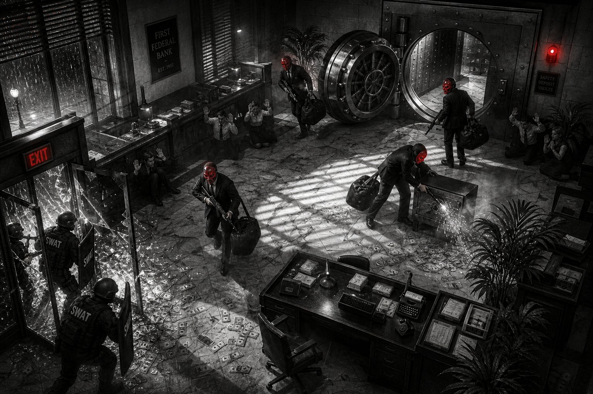
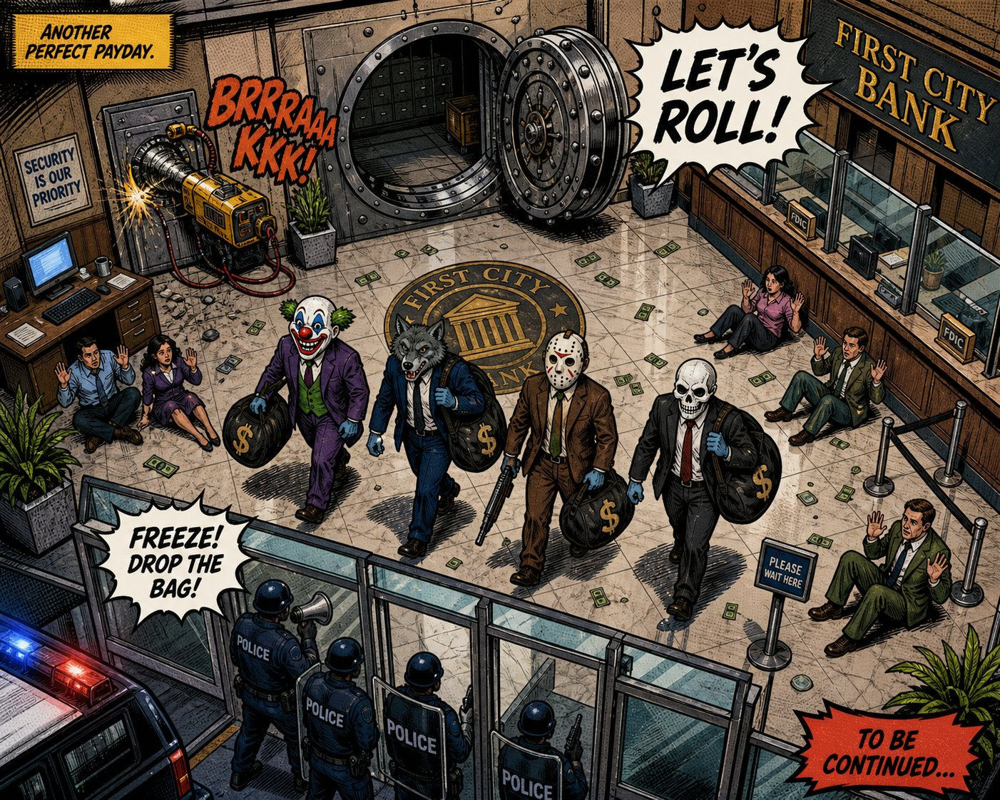
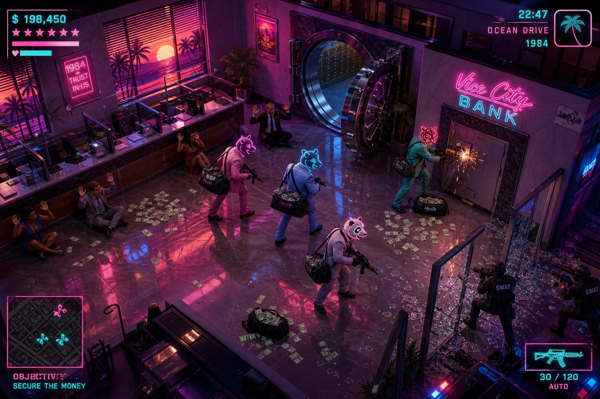
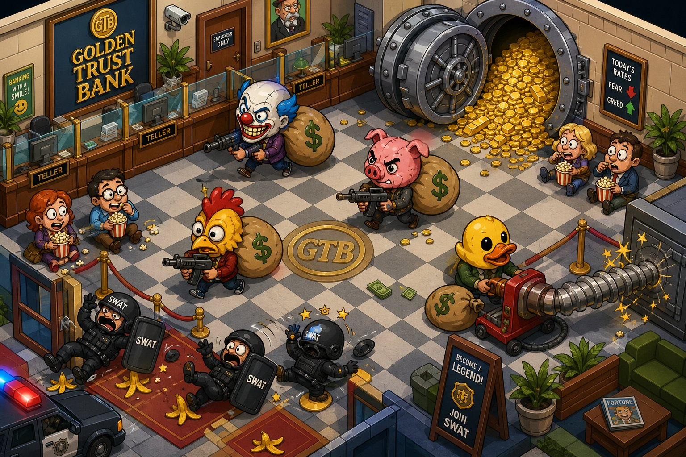
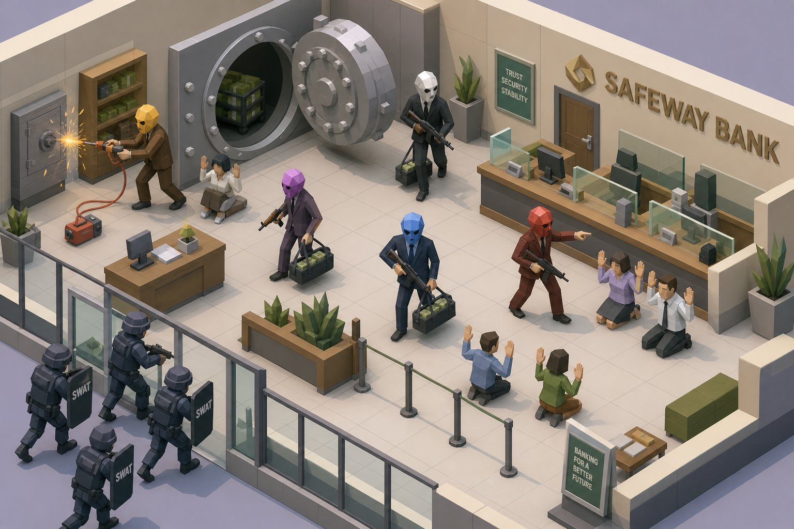
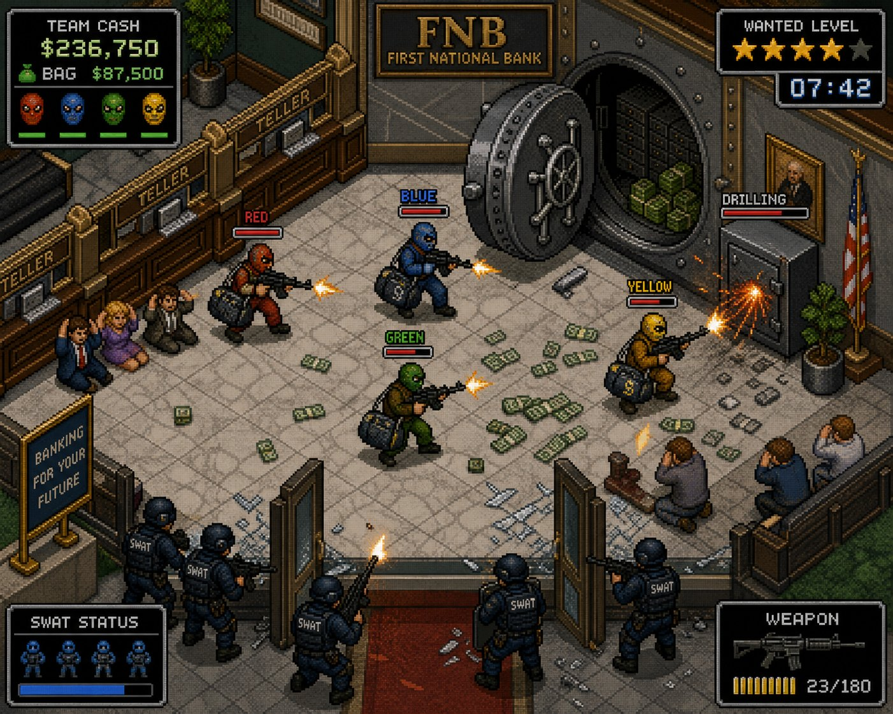
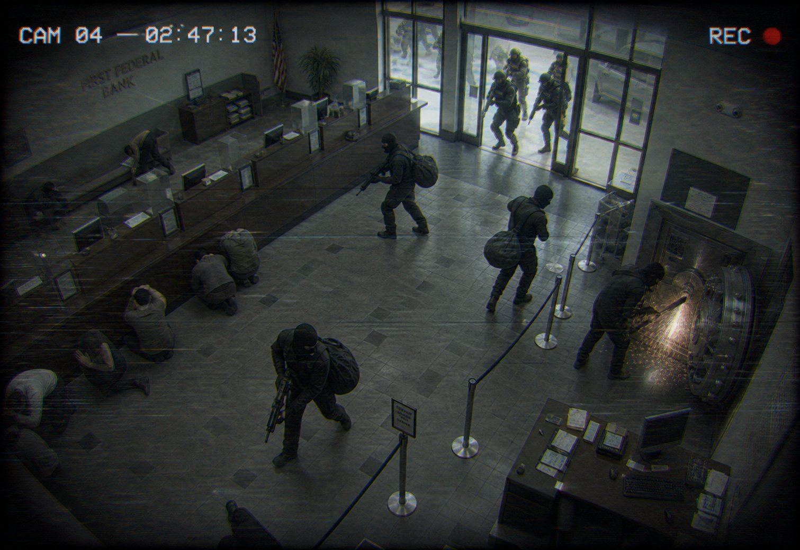

# 🎭 КОНЦЕПТ-АРТ: визуальные стили co-op heist shooter (изометрия, вид сверху)

**Проект:** вторая игра серии (после CS top-down). Жанр: кооперативный heist-шутер в духе Payday 2 — маски, стелс/loud, дрели, заложники, сумки с лутом, волны SWAT/FBI/Bulldozer, боты-напарники, LAN.

**Методология:** все концепты нарисованы на **одной и той же сцене** — ограбление банка в кульминации: 4 грабителя в масках тащат сумки, дрель пилит сейф, заложники на полу, SWAT врывается в стеклянный вход. Так стили сравниваются честно.

**Урок первой игры (CS top-down), учтённый во всех вариантах:** сверху персонаж читается по **голове/маске и силуэту плеч**, а не по телу. Поэтому во всех стилях маски — крупные, контрастные, у каждого игрока свой цвет/форма. Вторая заповедь: пол всегда светлее/спокойнее персонажей, иначе в loud всё сливается в кашу.

> ⚠️ Арты №4 и №5 упёрлись в лимит генерации изображений на ход — догенерируются следующим сообщением. Текстовые концепты для них полные.

---

## 1. «КРАСНЫЕ МАСКИ» / MIDNIGHT LEDGER — нуар 40-х

1. **Название:** «Красные маски» (Midnight Ledger)
2. **Стиль:** фильм-нуар 40-х, чёрно-белое кино с селективным цветом (как Sin City).
3. **Палитра:** монохром `#0A0A0C` → `#E8E6DF`, единственный цвет — кровь/маски/сигнализация `#C1121F`. Настроение: дождь, дым, жалюзи.
4. **Персонажи и маски:** грабители — тёмные силуэты в костюмах-тройках, сверху видна только **красная фарфоровая маска** — мгновенный идентификатор. У каждого игрока свой оттенок/узор маски (трещина, слеза, улыбка). Полиция — серый SWAT с белыми надписями, Bulldozer — гигантский силуэт с красной лампой на шлеме.
5. **Локации:** ар-деко банк 1932 года, мрамор в прожилках, тени-полосы от жалюзи режут пол на «клетки света». Ювелирка — блики витрин белыми вспышками, казино — подпольный клуб с зелёными лампами (единственное место со вторым акцентным цветом).
6. **Эффекты:** вспышки выстрелов — ослепительно белые, дым — объёмные серые клубы, искры дрели — белый фонтан в полутьме. Кровь — единственная красная жидкость в игре, поэтому бьёт по глазам. Деньги — серые пачки, зато сумки подсвечены красной биркой.
7. **Стелс/шум:** конусы зрения = **буквальные лучи фонарей и прожекторов** (свет — главная механика стиля). Шум — расходящиеся кольца, как круги на луже под дождём. Тревога: края экрана заливает красным — впервые за игру цвет «вырывается» наружу.
8. **HUD:** газетная полоса 40-х: здоровье — «шкала» печатной машинкой, таймер — карманные часы, мини-карта — вырезка-схема из газеты, лут — строка в гроссбухе «$ 240,000 — вынесли».
9. **Атмосфера:** фатализм и цинизм. Все знают, чем кончится, но идут до конца. Самая «взрослая» и мрачная версия.
10. **Референсы:** Sin City, L.A. Noire, Mafia: The City of Lost Heaven, «Двойная страховка», «Мальтийский сокол».
11. **Сложность:** **СРЕДНЯЯ.** Монохром прощает арт и ускоряет спрайты, но стиль держится на качественных тенях/свете — в Canvas это делается масками затемнения, выполнимо.

---

## 2. «ЧЕРНИЛА И СВИНЕЦ» / INK & AMMUNITION — комикс / графический роман

1. **Название:** «Чернила и свинец» (Ink & Ammunition)
2. **Стиль:** криминальный графический роман: жирные чернильные контуры, halftone-точки, ручная штриховка. Духовный наследник арта оригинального Payday.
3. **Палитра:** плоские печатные цвета на бумаге `#EDE3CE`: жёлтый `#F2C230`, красный `#C0392B`, полицейский синий `#1B2A4A`, чернила `#14100C`.
4. **Персонажи и маски:** классика жанра — клоун, волк, хоккейная, череп. Сверху маски читаются как большие цветные «значки», плюс контур игрока подкрашен его цветом. Силуэты чуть гипертрофированы: плечи шире, оружие крупнее.
5. **Локации:** уровень = страница комикса. Банк с мозаичным логотипом на полу, все поверхности в лёгкой штриховке, вывески написаны «от руки». Переходы между комнатами — как между панелями.
6. **Эффекты:** звукоподражания прямо в мире: `RATATA!`, `CLANG!`, `WHIRR!` у дрели. Вспышки — жёлтые звёзды, дым — облачка с контуром, кровь — чернильные брызги. Попадание по Bulldozer — огромный `THUNK!`.
7. **Стелс/шум:** над охранником растёт `?` → `!` в речевом баббле. Конусы зрения — halftone-градиент от жёлтого к красному. Шумные действия рождают подпись в точке шума (`CRASH!`) — охрана буквально «слышит» текст.
8. **HUD:** рамки комикс-панелей, заголовки `EXTRA! EXTRA!`, здоровье команды — портреты-маски в рамках, как на обложке выпуска. Финал ограбления — плашка `TO BE CONTINUED…`.
9. **Атмосфера:** дерзость и драйв. Игроки — герои графического романа, и им это нравится.
10. **Референсы:** Payday: The Heist (промо-арт), XIII, Borderlands, комиксы Фрэнка Миллера, «Пипец».
11. **Сложность:** **СРЕДНЯЯ.** Обводка и halftone делаются процедурно (паттерны + контуры спрайтов), но стиль требует дисциплины в каждом ассете.

---

## 3. «НЕОНОВОЕ ХРАНИЛИЩЕ» / NEON VAULT '84 — Майами 80-х

1. **Название:** «Неоновое хранилище» (Neon Vault '84)
2. **Стиль:** синтвейв / ретро-вейв, ночной Майами, Hotline Miami встречает Vice City.
3. **Палитра:** ночь `#2A0A4A`, розовый неон `#FF2E9A`, циан `#00E5FF`, закатный `#FFD319`. Всё светится, пол — зеркало.
4. **Персонажи и маски:** пастельные костюмы (розовый, мятный, белый), маски животных — **светящиеся неоновые контуры** (тигр, волк, панда): каждый игрок = свой цвет свечения, виден через весь зал. SWAT — чёрные силуэты, подсвеченные только мигалками красно-синим.
5. **Локации:** ночной банк с неоновой вывеской, пальмы и закат в панорамных окнах, глянцевый пол с отражениями. Казино в этом стиле — абсолютный рай: автоматы, рулетки, всё мигает. Ювелирка — бутик на Ocean Drive.
6. **Эффекты:** трассеры как лазерные лучи, розовые вспышки, глитч-искажение при взрывах, фиолетовый дым диско-машины. Искры дрели — оранжевый фейерверк на фоне фиолетовой ночи. Лут на мини-карте светится зелёным неоном.
7. **Стелс/шум:** сигнализация = **лазерная сетка** в хранилище (механика и стиль совпадают). Конусы камер — лучи диско-прожекторов. Шум визуализируется эквалайзером: от источника звука расходятся неоновые столбики в ритм саундтрека.
8. **HUD:** как на концепте — розовые звёзды розыска, кассовый счётчик денег, VHS-шрифт «OCEAN DRIVE 1984», мини-карта в неоновой рамке, иконка оружия контурным неоном.
9. **Атмосфера:** гламурный угар и скорость. Ограбление как вечеринка, где что-то пошло не так.
10. **Референсы:** Hotline Miami, GTA: Vice City, «Полиция Майами», «Драйв», «Лицо со шрамом».
11. **Сложность:** **ЛЕГКО–СРЕДНЯЯ.** Неон = glow-эффекты и аддитивный блендинг в Canvas, тёмный фон прощает низкую детализацию. Один из самых «выгодных» стилей по соотношению красота/труд.

---

## 4. «ПРОФЕССИОНАЛЫ» / HEATLINE — грязный реализм

> 🎨 *Арт догенерируется (лимит генерации на ход). Представь: та же сцена, снятая как кадр из «Heat» — пыль в лучах дневного света, серые костюмы, хоккейные маски, никакого глянца.*

1. **Название:** «Профессионалы» (Heatline)
2. **Стиль:** кинематографичный реализм Майкла Манна. Документальная грязь, ноль стилизации.
3. **Палитра:** выцветшая: серый асфальт `#6B7280`, пыль `#8C7A5F`, холодный дневной свет `#B8C4CE`, потёртый оливковый `#4A4A44`.
4. **Персонажи и маски:** белые хоккейные маски, серые костюмы, бронежилеты поверх. Реалистичные пропорции. Игроки различаются мелочами: цвет сумки, повязка на рукаве, цифра на спине броника — как в настоящей команде. Bulldozer — сапёрный EOD-костюм.
5. **Локации:** настоящий банк Лос-Анджелеса: потрескавшийся мрамор, пыль, следы обуви, разбитое стекло хрустит бликами. Казино — прокуренное и тусклое, ювелирка — холодный дневной свет витрин.
6. **Эффекты:** пыль из бетона от пуль, плотный серый дым, короткие реалистичные вспышки без трассеров. Кровь — минимально и неприятно. Дрель — дым, окалина, визг металла (экран у дрели слегка дрожит).
7. **Стелс/шум:** хардкор: конусы зрения — едва заметная дымка, никаких ярких подсказок. Шум — только реакция охраны (поворот головы, рука к рации) и субтитры радиопереговоров. Самый «честный» и сложный стелс.
8. **HUD:** почти отсутствует, как bodycam: здоровье — виньетка и дыхание, мини-карты нет (план здания на TAB — фото распечатки), деньги — сухая строка текста.
9. **Атмосфера:** предельное напряжение профессионалов. «Если почувствую жар за углом — за 30 секунд меня нет».
10. **Референсы:** «Heat / Схватка» (1995), «Сикарио», «Охота на воров», Ready or Not, GTA IV.
11. **Сложность:** **СЛОЖНАЯ.** ⚠️ Реализм при виде сверху спрайтами очень легко превращается в нечитаемое «грязное месиво»: мелкие реалистичные фигурки сливаются с полом. Самый дорогой и рискованный арт из девяти.

---

## 5. «ЧЕРТЁЖ» / THE BLUEPRINT — план ограбления

> 🎨 *Арт догенерируется (лимит генерации на ход). Представь: весь уровень — синий лист-синька, банк нарисован белыми линиями с размерами, маршруты команды — пунктир со стрелками, красным маркером обведены камеры.*

1. **Название:** «Чертёж» (The Blueprint)
2. **Стиль:** архитектурная синька / технический план. Игра происходит прямо на столе планирования.
3. **Палитра:** синька `#0B3D91`, белые линии `#FFFFFF`, пометки цианом `#7FD4FF`, красный маркер `#FF3B30` — только опасность и правки плана.
4. **Персонажи и маски:** белые контурные фигурки сверху с подписями `01 «WOLF»`, маска — пиктограмма в кружке у плеча. Полиция — красные контуры, заложники — пунктирные серые, Bulldozer — двойной жирный контур с подписью `⚠ JUGGERNAUT`.
5. **Локации:** буквально план этажа: размерные линии (`VAULT — 4,2 m`), миллиметровая сетка, штамп чертежа в углу листа, кофейное пятно на углу карты. Каждая локация — новый «лист» в папке плана.
6. **Эффекты:** выстрелы — пунктирные траектории с крестиками попаданий, взрыв — схема радиуса с подписью, дрель — аннотация со стрелкой `DRILL 68% ⏱ 1:12`, дым — диагональная штриховка. Сумки лута — иконки `$` в квадратах с весом `12 kg`.
7. **Стелс/шум:** **родная стихия стиля.** Конусы камер и охраны — заштрихованные сектора, маршруты патрулей — пунктир с точками поворотов, шум — окружность с подписью `NOISE r=12 m`. Игрок видит план как настоящий планировщик — стелс становится головоломкой.
8. **HUD:** отдельного HUD нет — весь экран и есть интерфейс: легенда чертежа, список задач как примечания на полях, таймер — секундомер, нарисованный в углу листа. Loud-фаза: по чертежу «проступают» красные правки маркером — план трещит по швам.
9. **Атмосфера:** холодный расчёт и интеллектуальный азарт. Идеальное преступление на бумаге… до первого выстрела.
10. **Референсы:** Monaco: What's Yours Is Mine, Invisible, Inc., сцены планирования из «11 друзей Оушена», Hitman GO (диорамы-планы).
11. **Сложность:** **ЛЁГКАЯ.** Чистая векторная графика линиями в Canvas, ноль спрайтов, феноменальная читаемость стелса. Риск: в loud-фазе может не хватить «мяса» и драйва — лечится красными маркерными эффектами и тряской «листа».

---

## 6. «МАСКИ-ШОУ» / MASKED MAYHEM — мультяшный cel-shaded

1. **Название:** «Маски-шоу» (Masked Mayhem)
2. **Стиль:** гротескный мультфильм, cel-shading, пропорции «огромная голова — крошечные ноги», чёрный юмор.
3. **Палитра:** конфетная и насыщенная: жёлтый `#FFD54A`, алый `#FF5A5F`, бирюза `#3EC1D3`, золото горкой `#F5B301`.
4. **Персонажи и маски:** маски = гигантские головы: маниакальный клоун, злая свинья, петух, резиновая уточка. Тела комично маленькие, сумки больше самих грабителей. SWAT — неуклюжие толстяки, Bulldozer — ходячий холодильник в броне.
5. **Локации:** игрушечный банк «Golden Trust»: шахматный пол, золото сыплется из хранилища горой, как у Скруджа Макдака, таблички шутят («FEAR ↓ GREED ↑»). Всё округлое, мягкое, яркое.
6. **Эффекты:** звёздочки и облачка `БУМ!`, крови нет — над головами кружатся звёзды, монеты фонтаном с всплывающим `+$500`. Дрель — карикатурно гигантская, на колёсиках. SWAT поскальзывается на банановой кожуре (это может быть настоящим гаджетом!).
7. **Стелс/шум:** спящий охранник с `Zzz`, конусы зрения — мягкие жёлтые пятна-лужицы света, шум — мультяшные звуковые волны и ноты. Заложники едят попкорн и болеют за грабителей — мораль команды растёт.
8. **HUD:** округлые плашки, жирный мультяшный шрифт, здоровье — сердечки, лут — мешки с `$`, таймер — будильник, который трясётся.
9. **Атмосфера:** хаос, смех и вечеринка. Самая дружелюбная к новичкам и стримерам версия — каждый забег превращается в комедию.
10. **Референсы:** Overcooked (кооп-хаос), Human: Fall Flat, мультфильмы Текса Эйвери, «Маска» с Джимом Керри, The Escapists 2.
11. **Сложность:** **СРЕДНЯЯ.** Стиль держится на squash-and-stretch анимации и гэгах — спрайты несложные, но юмор и «сок» (juice) придётся полировать весь проект.

---

## 7. «ПОЛИГОНАЛЬНЫЙ НАЛЁТ» / POLYVAULT — low-poly псевдо-3D

1. **Название:** «Полигональный налёт» (Polyvault)
2. **Стиль:** low-poly диорама: гранёные модели, плоская заливка без текстур, уровень как архитектурный макет на столе.
3. **Палитра:** спокойная пастель: беж `#D9D3C3`, серо-синий SWAT `#8FA3B8`, а маски — яркие «кристаллы»: `#FFC93C`, `#B388FF`, `#FF5252`, `#4FC3F7`.
4. **Персонажи и маски:** маски — гранёные геометрические головы разного цвета и формы граней: **идеальная идентификация игроков** даже в самой гуще боя. Тела угловатые, анимация чуть «деревянная» — это часть шарма.
5. **Локации:** миниатюрный макет банка: чистые плоскости, мягкие тени, растения-конусы, мебель-параллелепипеды. Уровень выглядит как дорогая дизайнерская диорама.
6. **Эффекты:** осколки-полигоны разлетаются кубиками, частицы искр — маленькие тетраэдры, деньги — аккуратные зелёные «кирпичики» пачек. Вспышки — плоские звезды-спрайты.
7. **Стелс/шум:** конусы зрения — полупрозрачные цветные вееры-плоскости, лежащие на полу как часть диорамы. Шум — расширяющиеся плоские кольца. Всё предельно читаемо.
8. **HUD:** чистый современный UI в духе мобильных премиум-игр: плоские иконки, мягкие тени плашек, мини-карта — та же диорама строго сверху.
9. **Атмосфера:** стильная, спокойная уверенность. Ограбление как дизайнерский объект — «красиво жить не запретишь».
10. **Референсы:** Hitman GO, Monument Valley, Mini Motorways, Totally Accurate Battle Simulator.
11. **Сложность:** **СРЕДНЯЯ.** Честная 3D через Three.js даст свет и тени «бесплатно», но усложнит физику/LAN; фейковая изометрия спрайтами в Canvas — проще и надёжнее для нашего стека. В обоих случаях арт-пайплайн быстрый: формы простые, текстур нет.

---

## 8. «16-БИТНЫЕ НАЛЁТЧИКИ» / 16-BIT BANDITS — пиксель-арт

1. **Название:** «16-битные налётчики» (16-Bit Bandits)
2. **Стиль:** пиксель-арт эпохи SNES, изометрия, ограниченная палитра, дизеринг.
3. **Палитра:** ~32 цвета: тёплое дерево банка `#8B5A2B`, мрамор `#CFC8B8`, а команда — чистые цвета масок и комбезов: RED / BLUE / GREEN / YELLOW.
4. **Персонажи и маски:** цветные балаклавы + тело в цвет маски (как на концепте): сверху игрок считывается мгновенно, как фишка. SWAT — тёмно-синие спрайты, Bulldozer — спрайт двойного размера с пулемётом.
5. **Локации:** тайловые полы из мрамора 16×16, пиксельные CRT-мониторы, флаги и таблички FNB, витрины ювелирки с бликующими 2-пиксельными бриллиантами.
6. **Эффекты:** вспышки — 3-кадровые спрайты, пиксельные осколки стекла, дым дизерингом, попадание — классическое мигание белым. Искры дрели — оранжевые пиксельные фонтанчики.
7. **Стелс/шум:** конусы — полупрозрачная заливка с шахматным дизерингом, пиксельный `!` над головой охранника, шум — дрожащая иконка уха. Всё по канонам ретро-стелса.
8. **HUD:** как на концепте: `TEAM CASH $236,750`, портреты масок команды с полосками HP, звёзды `WANTED LEVEL`, таймер ограбления `07:42`, патроны полосками-гильзами. Ностальгия в каждой плашке.
9. **Атмосфера:** аркадный азарт «ещё один забег — и спать». Самая «играбельная» и честная ретро-энергия.
10. **Референсы:** Hotline Miami, GTA 1/2, Enter the Gungeon, Shadowrun (SNES).
11. **Сложность:** **ЛЕГКО–СРЕДНЯЯ.** Рендер в низком разрешении с апскейлом — быстрый и прощает арт; анимации по 2–4 кадра. Но хороший пиксель-арт — это вкус в каждом спрайте, халява видна сразу.

---

## 9. «ПЛЁНКА №7» / TAPE_07 // CAM 04 — VHS / камеры наблюдения

1. **Название:** «Плёнка №7» (TAPE_07 // CAM 04)
2. **Стиль:** found footage: вся игра — запись с камер наблюдения банка. Аналог-хоррор встречает heist.
3. **Палитра:** выцветший серо-зелёный `#6A7268`, монохром ночного видения, единственный акцент — красная точка `● REC`.
4. **Персонажи и маски:** все в балаклавах, фигуры размыты motion-blur'ом — и тут стиль рождает механику: **система наблюдения сама рисует рамки трекинга** `SUSPECT-1…4` вокруг грабителей. Игроки различаются номерами рамок и нашивками. SWAT помечается `UNIT-7`, Bulldozer — `⚠ UNIDENTIFIED`.
5. **Локации:** вид строго с потолочных камер: лёгкий фишай, тёмные углы. Переход в другую комнату — «переключение камеры» с помехой и сменой подписи `CAM 05`. **Слепые зоны камер — настоящая стелс-механика**, а не украшение.
6. **Эффекты:** взрывы бьют по камере глитчем и трекинг-полосами, вспышки переэкспонируют кадр в белый, интерлейсинг на быстром движении. Дрель в кадре ночной камеры — ослепительный сноп искр с хроматической аберрацией.
7. **Стелс/шум:** попали в кадр — рамка трекинга желтеет и растёт `% ОПОЗНАНИЯ`; 100% — тревога. Шум — осциллограмма звука внизу кадра: охрана за стеной «слышит» пики. Отключение камер в серверной — ключевой стелс-объект.
8. **HUD:** таймер = таймкод `02:47:13`, здоровье = качество сигнала вашего «трека» (чем хуже HP, тем сильнее помехи вокруг фигурки), лут — протокол `EVIDENCE BAGGED: 6`.
9. **Атмосфера:** тревожная документальность. «Эту кассету нашли в сгоревшем фургоне». Самый атмосферно-необычный вариант.
10. **Референсы:** Manhunt (CCTV-эстетика), Outlast, аналог-хорроры (Local 58), фильм «[REC]».
11. **Сложность:** **СРЕДНЯЯ.** Вся магия — дешёвые пост-эффекты поверх обычного арта (шум, виньетка, хроматика). Риск: переборщить с помехами и убить читаемость/утомить глаза — нужна тонкая настройка и опция «чистый сигнал».

---

## 📊 Сравнительная таблица

| # | Стиль | Стелс-читаемость | Loud-драйв | Уникальность | Сложность | Риск |
|---|-------|:---:|:---:|:---:|:---:|------|
| 1 | Нуар «Красные маски» | ★★★★ (свет/тени) | ★★★ | ★★★★★ | Средняя | Тени в Canvas |
| 2 | Комикс «Чернила и свинец» | ★★★★ | ★★★★★ | ★★★ | Средняя | Дисциплина стиля |
| 3 | Неон «Neon Vault '84» | ★★★★ (лазеры) | ★★★★★ | ★★★★ | Легко–средняя | Неон утомляет глаза |
| 4 | Реализм «Heatline» | ★★ | ★★★ | ★★ | **Сложная** | Нечитаемость сверху |
| 5 | Чертёж «The Blueprint» | ★★★★★ | ★★ | ★★★★★ | **Лёгкая** | «Сухость» экшена |
| 6 | Мульт «Masked Mayhem» | ★★★★ | ★★★★ | ★★★★ | Средняя | Нужна анимация/гэги |
| 7 | Low-poly «Polyvault» | ★★★★★ | ★★★ | ★★★★ | Средняя | Выбор 3D vs 2.5D |
| 8 | Пиксель «16-Bit Bandits» | ★★★★ | ★★★★ | ★★ | Легко–средняя | Вкус в спрайтах |
| 9 | VHS «TAPE_07» | ★★★★★ (камеры!) | ★★★ | ★★★★★ | Средняя | Помехи vs читаемость |

## 🎯 Рекомендация геймдизайнера (не навязываю — выбор за тобой)

- **Самый безопасный и стильный:** №3 Неон или №2 Комикс — яркие маски, дешёвый «сок», отлично смотрятся и в стелсе, и в loud.
- **Самый уникальный и дешёвый в производстве:** №5 Чертёж — стелс в нём гениален, а арт делается линиями; игра будет ни на что не похожа.
- **Самый атмосферный:** №9 VHS — камеры как механика стелса + дешёвые пост-эффекты.
- **Осторожно:** №4 Реализм — при виде сверху в браузере он, скорее всего, проиграет всем по читаемости и съест больше всего времени.

Возможны **гибриды**: например, геймплей в неоне (№3), а экран планирования ограбления — чертёж (№5); или комикс (№2) + VHS-вставки с камер в брифинге (№9). Скажи, если хочешь гибрид.
